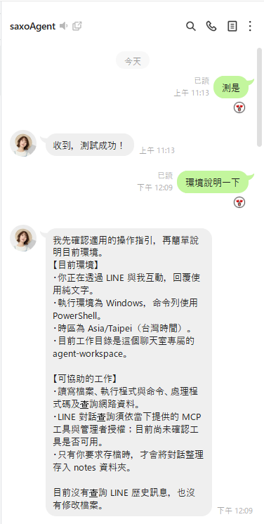

# LINE Agent Assistant

[English](README.md) · [繁體中文](README.zh-TW.md) · [日本語](README.ja.md) · [한국어](README.ko.md)

[](https://github.com/Saxo0213/line-agent-assistant/releases/latest) [](https://github.com/Saxo0213/line-agent-assistant/releases)  [](LICENSE)

**Claude や Codex に LINE のトークを任せましょう。** AI エージェントが LINE で指示を受け取り、トーク履歴を検索・要約し、ローカルの MCP bridge を通じて Claude Desktop や Codex から LINE を使えるようにする Windows デスクトップアプリです。

## 機能

<table>
<tr>
<td width="60%" valign="top">
<p>同じ Windows PC 上で 2 つの LINE アカウントに役割を分担させます。</p>
<ul>
<li><strong>Agent アカウント：</strong> 専用の LINE アカウントで、アプリ内で QR コードでログインします（既定は Windows 版、Chrome 版も選択可）。LINE で管理者から指示を受け取り、ローカルにインストールされた Codex または Claude でタスクを実行し、スケジュール送信や代理送信も行います。</li>
<li><strong>メイン管理者アカウント：</strong> あなた自身の LINE アカウントで、管理コマンドを使えるのはこのアカウントだけです。監視モードで、この PC の LINE（PC 版）がローカルに保存したメッセージの記録を読み取り、アプリ内ではログインしません。任意の「ダウンロード用ログイン」では、Google Chrome と LINE Chrome 拡張機能 3.7.2 を使ってトークの写真とファイルをダウンロードできます。</li>
<li><strong>メッセージアシスタント：</strong> 両アカウントの会話と添付ファイルをまとめて確認し、過去のメッセージを検索できます。管理者は Agent に会話の要約も依頼できます。</li>
<li><strong>会話アシスタント：</strong> Agent を会話に参加させ、ファイルや画像のダウンロードを支援させたり、自動返信ルールを設定したりできます。</li>
<li><strong>MCP bridge：</strong> Claude Desktop と Codex から会話の一覧表示、ノートとアルバムの読み取り、設定したアカウント権限の範囲内でのメッセージ送信や予約ができます。エンドポイントはこの PC（127.0.0.1）でのみ待ち受けます。</li>
</ul>
</td>
<td width="40%" valign="top"></td>
</tr>
</table>

v1.0.342 では、メイン管理者の「ダウンロード用ログイン」（写真とファイルのダウンロード）、設定画面の「ログインの説明」、Agent の返信への引用メッセージとファイルの受け渡し、@メンションで動くメッセージルール、取り消されたメッセージの記録を追加しました。アプリの「更新を確認」からインストールできます。詳細は [v1.0.323 → v1.0.342 リリースノート](docs/releases/v1.0.342.md)をご覧ください。

## インストール

> [!WARNING]
> Agent には個人のメインアカウントではなく、専用の LINE アカウントを使用してください。本アプリは非公式の LINE プロトコルで接続するため、LINE 側の変更、端末認証、アカウントポリシーの適用によって利用できなくなる場合があります。ローカルの MCP エンドポイントにはトークン認証がなく、この PC 上のどのプログラムからでも保存済みの LINE メッセージを読み取れます。信頼できない人と共有している PC では使用しないでください。

### Windows インストーラー

[最新のリリース](https://github.com/Saxo0213/line-agent-assistant/releases/latest)を開き、**Assets** からファイル名が `Setup-x64.exe` で終わるインストーラーをダウンロードして実行してください。

### ソースからのビルド

Windows x64 と対応する Node.js を用意し、[ソースからのビルド](docs/BUILDING.md)に記載された要件を満たしてください。その後、次を実行します。

```powershell
npm ci
npm run build
npm run start --workspace @line-agent/desktop
```

## 初回起動とログイン

初回起動時は、画面の案内に従って内蔵データベースをインストールします。アカウントがまだない場合、アプリは「設定 → システム」を開き、アカウント欄の上にある「ログインの説明」に次の手順と完了状態が表示されます。

1. **Agent アカウントにログイン（必須）**
   - 用途：AI アシスタントとして使う専用の LINE アカウントです。LINE でメッセージを送ると、この PC の Claude または Codex が処理して返信します。スケジュール送信や代理送信も、このアカウントが行います。
   - ログイン：「Agent」で「Agent の LINE アカウントにログイン」を押し、「Windows 版」を選びます。次に、Agent アカウントのスマートフォンの LINE で QR コードをスキャンし、認証コードを入力します。
   - 専用アカウントを使い、普段使っているメインの個人アカウントは使わないでください。
2. **メイン管理者を設定（必須）**
   - 用途：あなた自身の LINE アカウントです。管理コマンド（例：`/權限`、`/folder`）を使えるのはメイン管理者だけです。トーク履歴はこの PC の LINE（PC 版）から取り込まれ、アプリで閲覧・検索できます。メイン管理者はアプリ内で QR コードによるログインをしません。
   - 設定：この PC で LINE（PC 版）を開いてアカウントにログインし、「管理者アカウント（LINE 監視モード）」を押します。
   - または、Agent のカードで「管理者を追加」を押し、3 分以内に、あなたの LINE から Agent との 1 対 1 のトークで画面に表示された 6 桁の認証コードを送信します。
3. **AI を準備（必須）**：「設定 → アシスタント」で Claude または Codex の公式 CLI をインストールしてログインし、既定の Agent を選びます。
4. **ダウンロード用ログイン（任意）**
   - 用途：メイン管理者のトークにある写真とファイルをダウンロードします。Google Chrome と LINE Chrome 拡張機能 3.7.2 が必要です。
   - 設定：「Primary Admin」で「ダウンロード用にログイン」を押し、メイン管理者のスマートフォンの LINE で QR コードをスキャンします。その後、メイン管理者が何かメッセージを 1 件送信すると、アカウントの確認が完了します。

## 参照したオープンソースプロジェクト

- [OkLine](https://github.com/NiceDayZc/OkLine)（[ドキュメント](https://nicedayzc.github.io/OkLine/#start-here)、[MIT License](https://github.com/NiceDayZc/OkLine/blob/main/LICENSE)）：LINE Chrome クライアントのログイン、ログアウト、トークン更新、サーバーレスポンス処理を比較・確認するための実装資料として参照しています。実行時の依存関係ではありません。
- [LINEJS / `@evex/linejs`](https://github.com/evex-dev/linejs)（[ドキュメント](https://linejs.evex.land)、[MIT License](https://github.com/evex-dev/linejs/blob/main/LICENSE)）：本アプリがバージョンを固定して利用する JavaScript 製 LINE クライアントライブラリで、LINE セッション、認証、プロトコル要求、認証情報の保存を提供します。

著作権表示およびライセンス条件は、各プロジェクトのリポジトリを参照してください。

## ライセンス

MIT License のもとで公開されています。詳しくは [LICENSE](LICENSE) をご覧ください。

## 非公式プロジェクトについて

本プロジェクトは独立した非公式プロジェクトです。LINE およびその関連会社とは提携しておらず、承認や支援も受けていません。
