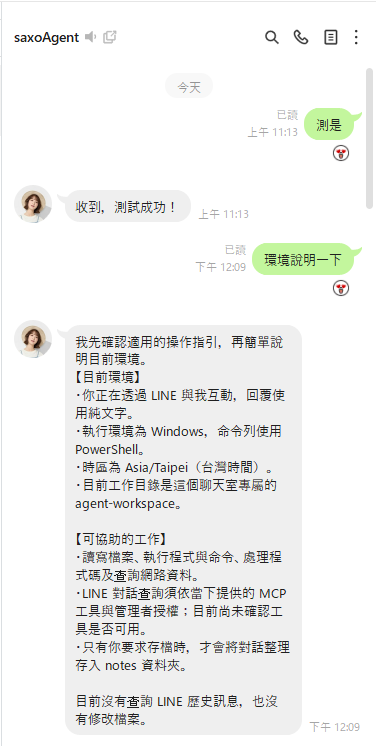

# LINE Agent Assistant

[English](README.md) · [繁體中文](README.zh-TW.md) · [日本語](README.ja.md) · [한국어](README.ko.md)

## 機能

<table>
<tr>
<td width="60%" valign="top">
<p>LINE の Chrome 型クライアントのセッションを利用し、同じ Windows PC 上で 2 つの LINE アカウントに役割を分担させます。</p>
<ul>
<li><strong>Agent アカウント：</strong> LINE にログインして管理者から指示を受け取り、ローカルにインストールされた Codex または Claude でタスクを実行します。</li>
<li><strong>管理者アカウント：</strong> ログインモードと監視モードを選べます。監視モードでは、LINE がローカルに保存したメッセージの記録を読み取ります。</li>
<li><strong>メッセージアシスタント：</strong> 両アカウントの会話と添付ファイルをまとめて確認し、過去のメッセージを検索できます。管理者は Agent に会話の要約も依頼できます。</li>
<li><strong>会話アシスタント：</strong> Agent を会話に参加させ、ファイルや画像のダウンロードを支援させたり、自動返信ルールを設定したりできます。</li>
</ul>
</td>
<td width="40%" valign="top"></td>
</tr>
</table>

v1.0.316 ではグループとルームの添付ファイルをチャットごとに保存し、送信者と元のファイル名を表示します。一時フォルダー用の `/folder` 操作も追加しました。再起動後の更新通知とインストール済みバージョンの照合も修正しています。アプリの「更新を確認」からインストールできます。公開版 v1.0.314 からの変更（ローカル v1.0.315 で先行した添付機能を含む）は [v1.0.316 リリースノート](docs/releases/v1.0.316.md)をご覧ください。

## インストール

### Windows インストーラー

[最新のリリース](https://github.com/Saxo0213/line-agent-assistant/releases/latest)を開き、**Assets** からファイル名が `Setup-x64.exe` で終わるインストーラーをダウンロードして実行してください。

### ソースからのビルド

Windows x64 と対応する Node.js を用意し、[ソースからのビルド](docs/BUILDING.md)に記載された要件を満たしてください。その後、次を実行します。

```powershell
npm ci
npm run build
npm run start --workspace @line-agent/desktop
```

## 参照したオープンソースプロジェクト

- [OkLine](https://github.com/NiceDayZc/OkLine)（[ドキュメント](https://nicedayzc.github.io/OkLine/#start-here)、[MIT License](https://github.com/NiceDayZc/OkLine/blob/main/LICENSE)）：LINE Chrome クライアントのログイン、ログアウト、トークン更新、サーバーレスポンス処理を比較・確認するための実装資料として参照しています。実行時の依存関係ではありません。
- [LINEJS / `@evex/linejs`](https://github.com/evex-dev/linejs)（[ドキュメント](https://linejs.evex.land)、[MIT License](https://github.com/evex-dev/linejs/blob/main/LICENSE)）：本アプリがバージョンを固定して利用する JavaScript 製 LINE クライアントライブラリで、LINE セッション、認証、プロトコル要求、認証情報の保存を提供します。

著作権表示およびライセンス条件は、各プロジェクトのリポジトリを参照してください。

## ライセンス

MIT License のもとで公開されています。詳しくは [LICENSE](LICENSE) をご覧ください。

## 非公式プロジェクトについて

本プロジェクトは独立した非公式プロジェクトです。LINE およびその関連会社とは提携しておらず、承認や支援も受けていません。
