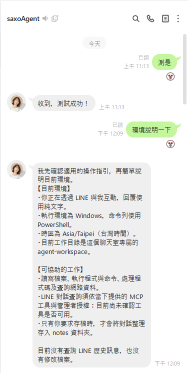

# LINE Agent Assistant

[English](README.md) · [繁體中文](README.zh-TW.md) · [日本語](README.ja.md) · [한국어](README.ko.md)

[](https://github.com/Saxo0213/line-agent-assistant/releases/latest) [](https://github.com/Saxo0213/line-agent-assistant/releases)  [](LICENSE)

**Claude나 Codex에게 LINE 대화를 맡기세요.** AI 에이전트가 LINE으로 지시를 받고, 대화 기록을 검색·요약하며, 로컬 MCP bridge를 통해 Claude Desktop과 Codex에서 LINE을 사용할 수 있게 해 주는 Windows 데스크톱 앱입니다.

## 기능

<table>
<tr>
<td width="60%" valign="top">
<p>한 대의 Windows 컴퓨터에서 두 LINE 계정이 역할을 나누어 수행합니다.</p>
<ul>
<li><strong>Agent 계정:</strong> 전용 LINE 계정으로, 앱에서 QR 코드로 로그인합니다(기본은 Windows 버전, Chrome 버전 선택 가능). LINE으로 관리자의 지시를 받아 로컬에 설치된 Codex 또는 Claude로 작업을 수행하고, 예약 메시지와 대리 발송 메시지도 보냅니다.</li>
<li><strong>주 관리자 계정:</strong> 본인의 LINE 계정으로, 관리 명령은 이 계정만 사용할 수 있습니다. 모니터링 모드로 이 컴퓨터의 PC 버전 LINE이 로컬에 저장한 메시지 기록을 읽으며, 앱에서는 로그인하지 않습니다. 선택 사항인 '다운로드용 로그인'은 Google Chrome과 LINE Chrome 확장 프로그램 3.7.2로 대화의 사진과 파일을 다운로드합니다.</li>
<li><strong>메시지 도우미:</strong> 두 계정의 대화와 첨부 파일을 한곳에서 확인하고, 과거 메시지를 검색하며, Agent에게 대화 요약을 요청할 수 있습니다.</li>
<li><strong>대화 도우미:</strong> Agent가 대화에 참여해 파일과 이미지 다운로드를 돕고 자동 응답 규칙을 설정할 수 있습니다.</li>
<li><strong>MCP bridge:</strong> Claude Desktop과 Codex에서 대화 목록 조회, 노트와 앨범 읽기, 설정한 계정 권한 범위 내의 메시지 전송과 예약을 할 수 있습니다. 엔드포인트는 이 컴퓨터(127.0.0.1)에서만 수신합니다.</li>
</ul>
</td>
<td width="40%" valign="top"></td>
</tr>
</table>

v1.0.342에서는 주 관리자의 '다운로드용 로그인'(사진과 파일 다운로드), 설정 화면의 '로그인 안내', Agent 답장에 인용 메시지와 파일 전달, @멘션으로 동작하는 메시지 규칙, 회수된 메시지 기록이 추가되었습니다. 앱의 '업데이트 확인'으로 설치할 수 있습니다. 자세한 내용은 [v1.0.323 → v1.0.342 릴리스 노트](docs/releases/v1.0.342.md)를 참조하세요.

## 설치

> [!WARNING]
> Agent에는 개인 주 계정이 아닌 전용 LINE 계정을 사용하세요. 이 앱은 비공식 LINE 프로토콜로 연결되므로 LINE 측 변경, 기기 인증, 계정 정책 적용으로 인해 사용할 수 없게 될 수 있습니다. 로컬 MCP 엔드포인트에는 토큰 인증이 없어 이 컴퓨터의 모든 프로그램이 저장된 LINE 메시지를 읽을 수 있으므로, 신뢰할 수 없는 사람과 함께 쓰는 컴퓨터에서는 사용하지 마세요.

### Windows 설치 파일

[최신 릴리스](https://github.com/Saxo0213/line-agent-assistant/releases/latest)를 열고 **Assets**에서 파일 이름이 `Setup-x64.exe`로 끝나는 설치 파일을 다운로드한 다음 실행하세요.

### 소스에서 빌드

Windows x64와 지원되는 Node.js 버전을 준비하고 [소스에서 빌드하기](docs/BUILDING.md)에 안내된 사전 요구 사항을 충족하세요. 그런 다음 다음 명령을 실행합니다.

```powershell
npm ci
npm run build
npm run start --workspace @line-agent/desktop
```

## 첫 실행과 로그인

첫 실행 시 화면 안내에 따라 내장 데이터베이스를 설치합니다. 아직 계정이 없으면 앱이 '설정 → 시스템'을 열고, 계정 영역 위의 '로그인 안내'에 다음 단계와 완료 상태가 표시됩니다.

1. **Agent 계정 로그인 (필수)**
   - 용도: AI 어시스턴트로 쓰는 전용 LINE 계정입니다. LINE에서 메시지를 보내면 이 PC의 Claude 또는 Codex가 처리한 뒤 답장합니다. 예약 메시지와 대리 발송 메시지도 이 계정이 보냅니다.
   - 로그인: “Agent”에서 “Agent LINE 계정 로그인”을 누르고 “Windows 버전”을 선택합니다. 그다음 Agent 계정의 휴대폰 LINE으로 QR 코드를 스캔하고 인증 코드를 입력합니다.
   - 전용 계정을 사용하고, 평소 쓰는 개인 주 계정은 사용하지 마세요.
2. **주 관리자 설정 (필수)**
   - 용도: 본인의 LINE 계정입니다. 관리 명령(예: `/權限`, `/folder`)은 주 관리자만 사용할 수 있습니다. 대화 기록은 이 PC의 PC 버전 LINE에서 가져오며 앱에서 보고 검색할 수 있습니다. 주 관리자는 앱에서 QR 코드로 로그인하지 않습니다.
   - 설정: 이 PC에서 PC 버전 LINE을 열고 계정에 로그인한 뒤 “관리자 계정 (LINE 모니터링 모드)”을 누릅니다.
   - 또는 Agent 카드에서 “관리자 추가”를 누르고, 3분 안에 본인의 LINE으로 Agent와의 1:1 대화에 화면에 표시된 6자리 인증 코드를 보냅니다.
3. **AI 준비 (필수)**: “설정 → 어시스턴트”에서 Claude 또는 Codex 공식 CLI를 설치하고 로그인한 뒤 기본 Agent를 선택합니다.
4. **다운로드용 로그인 (선택)**
   - 용도: 주 관리자 대화의 사진과 파일을 다운로드합니다. Google Chrome과 LINE Chrome 확장 프로그램 3.7.2가 필요합니다.
   - 설정: “Primary Admin”에서 “다운로드용 로그인”을 누르고 주 관리자의 휴대폰 LINE으로 QR 코드를 스캔합니다. 이후 주 관리자가 메시지를 하나 보내면 계정 확인이 완료됩니다.

## 참고한 오픈 소스 프로젝트

- [OkLine](https://github.com/NiceDayZc/OkLine) ([문서](https://nicedayzc.github.io/OkLine/#start-here), [MIT License](https://github.com/NiceDayZc/OkLine/blob/main/LICENSE)): LINE Chrome 클라이언트의 로그인, 로그아웃, 토큰 갱신 및 서버 응답 처리를 비교·확인하는 구현 참고 자료로 사용했습니다. 런타임 의존성은 아닙니다.
- [LINEJS / `@evex/linejs`](https://github.com/evex-dev/linejs) ([문서](https://linejs.evex.land), [MIT License](https://github.com/evex-dev/linejs/blob/main/LICENSE)): 이 앱이 버전을 고정해 사용하는 JavaScript LINE 클라이언트 라이브러리로, LINE 세션, 인증, 프로토콜 요청 및 인증 정보 저장을 제공합니다.

저작권 고지와 라이선스 조건은 각 프로젝트 저장소를 확인하세요.

## 라이선스

MIT License로 배포됩니다. 자세한 내용은 [LICENSE](LICENSE)를 참조하세요.

## 비공식 프로젝트 안내

이 프로젝트는 독립적인 비공식 프로젝트입니다. LINE 또는 그 계열사와 제휴 관계가 없으며, 이들의 승인이나 후원을 받지 않습니다.
