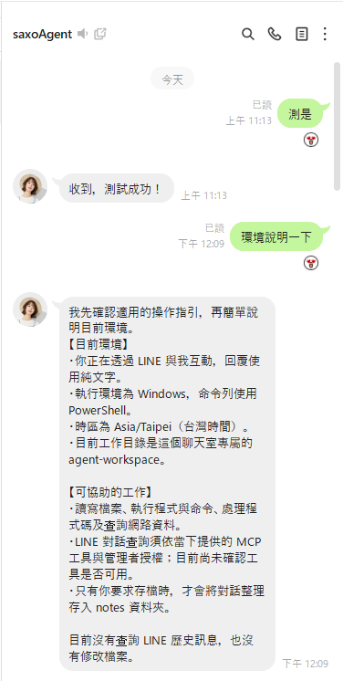

# LINE Agent Assistant

[English](README.md) · [繁體中文](README.zh-TW.md) · [日本語](README.ja.md) · [한국어](README.ko.md)

[](https://github.com/Saxo0213/line-agent-assistant/releases/latest) [](https://github.com/Saxo0213/line-agent-assistant/releases)  [](LICENSE)

**Put Claude or Codex to work on your LINE chats.** A Windows desktop app that lets an AI agent take instructions over LINE, search and summarize your chat history, and give Claude Desktop and Codex access to LINE through a local MCP bridge.

## Features

<table>
<tr>
<td width="60%" valign="top">
<p>The app lets two LINE accounts serve different roles on the same Windows computer:</p>
<ul>
<li><strong>Agent account:</strong> A dedicated LINE account that logs in inside the app by QR code (Windows version by default, Chrome version optional). It receives instructions from the administrator through LINE, runs tasks through a locally installed Codex or Claude agent, and sends scheduled and on-behalf messages.</li>
<li><strong>Primary administrator account:</strong> Your own LINE account, the only one that can use management commands. It uses monitoring mode: the app reads the message records that desktop LINE stores on this computer, and the account does not log in inside the app. An optional download login uses Google Chrome and the LINE Chrome extension 3.7.2 to download photos and files from its chats.</li>
<li><strong>Message assistant:</strong> Shows conversations and attachments from both accounts in one place, searches message history, and lets the administrator ask the Agent to summarize conversations.</li>
<li><strong>Conversation assistant:</strong> Lets the Agent participate in conversations, help download files and images, and set up automatic reply rules.</li>
<li><strong>MCP bridge:</strong> Lets Claude Desktop and Codex list conversations, read Notes and Albums, and send or schedule messages within the account permissions you set, through an endpoint that listens only on this computer (127.0.0.1).</li>
</ul>
</td>
<td width="40%" valign="top"></td>
</tr>
</table>

v1.0.342 adds a download login for the primary administrator (photos and files), a login guide in Settings, quoted messages and their files in Agent replies, message rules triggered by @mentions, and a record of recalled messages. Install through the app's **Check for updates**. See the [v1.0.323 → v1.0.342 release notes](docs/releases/v1.0.342.md) for the complete changes.

## Installation

> [!WARNING]
> Use a dedicated LINE account for the Agent, not your personal primary account. This app connects through an unofficial LINE protocol, so it can stop working after LINE changes, device verification, or account-policy enforcement. The local MCP endpoint has no token: any program on this computer can read stored LINE messages through it, so do not use the app on a computer shared with people you do not trust.

### Windows installer

Open the [latest release](https://github.com/Saxo0213/line-agent-assistant/releases/latest), download the installer whose filename ends in `Setup-x64.exe` under **Assets**, and run it.

### Build from source

To build and run the source code, use Windows x64, install a supported Node.js version, and follow the prerequisites in [Building from source](docs/BUILDING.md). Then run:

```powershell
npm ci
npm run build
npm run start --workspace @line-agent/desktop
```

## First launch and login

On first launch, follow the on-screen steps to install the built-in database. While no account exists, the app opens **Settings → System**, and the **Login guide** above the account section lists these steps and their status.

1. **Log in the Agent account (required)**
   - Purpose: a dedicated LINE account that works as the AI assistant. You send it a message in LINE, it passes the message to Claude or Codex on this PC, and it sends the reply. It also sends scheduled and on-behalf messages.
   - Log in: under **Agent**, click **Log in to Agent LINE account**, choose **Windows version**, then scan the QR code with LINE on the Agent account's phone and enter the verification code.
   - Use a dedicated account, not your main personal account.
2. **Set the primary administrator (required)**
   - Purpose: your own LINE account. Only the primary administrator can use management commands (for example `/權限` and `/folder`). Its chat history is imported from desktop LINE on this PC, so you can view and search it in the app. The primary administrator does not log in by QR code in the app.
   - Setup: open desktop LINE on this PC, log in to your account, then click **Administrator account (LINE monitor mode)**.
   - Or click **Add administrator** on the Agent card, then within 3 minutes send the 6-digit code shown on screen from your LINE in the 1-on-1 chat with the Agent.
3. **Prepare the AI (required):** go to **Settings → Assistant**, install and log in to the official Claude or Codex CLI, then choose the default Agent.
4. **Download login (optional)**
   - Purpose: download photos and files from the primary administrator's chats. It needs Google Chrome and the LINE Chrome extension 3.7.2.
   - Setup: under **Primary Admin**, click **Log in for downloads** and scan the QR code with LINE on the primary administrator's phone. After that, the primary administrator sends any message to finish the account check.

## Referenced open-source projects

- [OkLine](https://github.com/NiceDayZc/OkLine) ([documentation](https://nicedayzc.github.io/OkLine/#start-here), [MIT License](https://github.com/NiceDayZc/OkLine/blob/main/LICENSE)): Used as an implementation reference when comparing LINE Chrome client login, logout, token refresh, and server response handling. It is not a runtime dependency.
- [LINEJS / `@evex/linejs`](https://github.com/evex-dev/linejs) ([documentation](https://linejs.evex.land), [MIT License](https://github.com/evex-dev/linejs/blob/main/LICENSE)): The pinned JavaScript LINE client library used by this application for LINE sessions, authentication, protocol requests, and credential storage.

Copyright notices and license terms are maintained in each project's repository.

## License

Released under the MIT License. See [LICENSE](LICENSE).

## Non-affiliation

This is an independent, unofficial project. It is not affiliated with, endorsed by, or sponsored by LINE or any of its affiliated companies.
