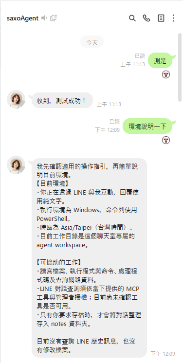

# LINE Agent Assistant

[English](README.md) · [繁體中文](README.zh-TW.md) · [日本語](README.ja.md) · [한국어](README.ko.md)

[](https://github.com/Saxo0213/line-agent-assistant/releases/latest) [](https://github.com/Saxo0213/line-agent-assistant/releases)  [](LICENSE)

**讓 Claude 或 Codex 幫你處理 LINE 對話。** 這是一套 Windows 桌面程式：AI Agent 可以透過 LINE 接收指令、搜尋並摘要你的聊天紀錄，還能經由本機 MCP bridge 讓 Claude Desktop 與 Codex 直接使用 LINE。

## 功能

<table>
<tr>
<td width="60%" valign="top">
<p>讓兩個 LINE 帳號在同一台 Windows 電腦上分工：</p>
<ul>
<li><strong>Agent 帳號：</strong> 專用的 LINE 帳號，在 App 內以 QR 碼登入（預設 Windows 版，也可選 Chrome 版），透過 LINE 接收管理者指令，交由本機的 Codex 或 Claude 執行任務，並送出排程與代發的訊息。</li>
<li><strong>主要管理者帳號：</strong> 你自己的 LINE 帳號，只有它能使用管理指令。採監控模式，讀取這台電腦上電腦版 LINE 的本機訊息紀錄，不在 App 內登入；可選用「下載登入」，透過 Google Chrome 與 LINE Chrome 擴充功能 3.7.2 下載它聊天中的照片與檔案。</li>
<li><strong>訊息助理：</strong> 集中查看兩個帳號的對話與附件、搜尋歷史訊息，並請 Agent 協助摘要對話內容。</li>
<li><strong>對話助理：</strong> 讓 Agent 參與對話，協助下載檔案與圖片，並設定自動回覆規則。</li>
<li><strong>MCP bridge：</strong> 讓 Claude Desktop 與 Codex 列出對話、讀取記事本與相簿，並在你設定的帳號權限內傳送或排程訊息；端點只在本機（127.0.0.1）監聽。</li>
</ul>
</td>
<td width="40%" valign="top"></td>
</tr>
</table>

v1.0.342 新增主要管理者的「下載登入」（下載照片與檔案），設定頁加入「登入說明」引導，Agent 回覆會帶上被引用的訊息與檔案，並新增 @提及觸發的訊息規則與收回訊息紀錄。可透過 App「檢查更新」安裝。完整變更請見 [v1.0.323 → v1.0.342 版本說明](docs/releases/v1.0.342.md)。

## 安裝

> [!WARNING]
> 請為 Agent 準備專用的 LINE 帳號，不要使用你的個人主要帳號。本程式透過非官方的 LINE 協定連線，LINE 變更協定、要求裝置驗證或執行帳號政策時，都可能導致無法使用。本機 MCP 端點沒有 Token 驗證，這台電腦上的任何程式都能透過它讀取已儲存的 LINE 訊息，因此請勿在與不信任的人共用的電腦上使用。

### Windows 安裝檔

前往[最新版本](https://github.com/Saxo0213/line-agent-assistant/releases/latest)，在 **Assets** 下載檔名結尾為 `Setup-x64.exe` 的安裝檔，執行後依畫面指示安裝。

### 從原始碼建置

請使用 Windows x64、安裝支援的 Node.js 版本，並依照[從原始碼建置](docs/BUILDING.md)準備必要項目。接著執行：

```powershell
npm ci
npm run build
npm run start --workspace @line-agent/desktop
```

## 首次啟動與登入

首次啟動時，依畫面完成內建資料庫安裝。還沒有任何帳號時，App 會開啟「設定 → 系統」，帳號區塊上方的「登入說明」會列出以下步驟與完成狀態。

1. **登入 Agent 帳號（必要）**
   - 用途：專用的 LINE 帳號，當作 AI 助理。你在 LINE 傳訊息給它，它交給這台電腦上的 Claude 或 Codex 處理後回覆；排程與代發的訊息也由它送出。
   - 登入：在「Agent」按「登入 Agent LINE 帳號」，選「Windows 版」，再用 Agent 帳號的手機 LINE 掃描 QR 碼並輸入驗證碼。
   - 請使用專用帳號，不要使用你的個人主要帳號。
2. **設定主要管理者（必要）**
   - 用途：你自己的 LINE 帳號。只有主要管理者能使用管理指令（例如 `/權限`、`/folder`）；它的聊天紀錄從這台電腦的電腦版 LINE 匯入，可在 App 查看與搜尋。主要管理者不在 App 內掃 QR 登入。
   - 設定：在這台電腦開啟電腦版 LINE 並登入你的帳號，再按「管理者帳號(LINE監控模式)」。
   - 也可以在 Agent 卡片按「新增管理」，3 分鐘內用你的 LINE 在與 Agent 的 1 對 1 聊天送出畫面上的 6 位數驗證碼。
3. **準備 AI（必要）**：到「設定 → 助理」安裝並登入 Claude 或 Codex 的官方 CLI，再選擇預設 Agent。
4. **下載登入（選用）**
   - 用途：下載主要管理者聊天中的照片與檔案。需要 Google Chrome 與 LINE Chrome 擴充功能 3.7.2。
   - 設定：在「Primary Admin」按「登入下載」，用主要管理者的手機 LINE 掃描 QR 碼；之後主要管理者送出任何一則訊息，即完成帳號確認。

## 參考的開源專案

- [OkLine](https://github.com/NiceDayZc/OkLine)（[說明文件](https://nicedayzc.github.io/OkLine/#start-here)、[MIT License](https://github.com/NiceDayZc/OkLine/blob/main/LICENSE)）：用於比對 LINE Chrome 用戶端的登入、登出、Token 更新與伺服器回應處理方式；本程式不在執行階段依賴 OkLine。
- [LINEJS / `@evex/linejs`](https://github.com/evex-dev/linejs)（[說明文件](https://linejs.evex.land)、[MIT License](https://github.com/evex-dev/linejs/blob/main/LICENSE)）：本程式固定版本使用的 JavaScript LINE 用戶端函式庫，提供 LINE 工作階段、登入驗證、協定請求與憑證儲存功能。

著作權聲明與授權條款以各專案的 Repository 為準。

## 授權

本專案採用 MIT License，詳見 [LICENSE](LICENSE)。

## 非官方聲明

本專案為獨立、非官方專案，與 LINE 或其任何關係企業均無隸屬、背書或贊助關係。
